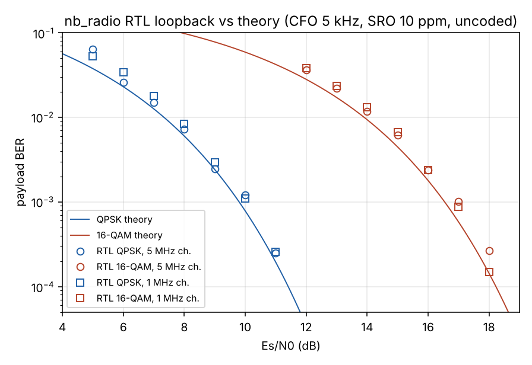
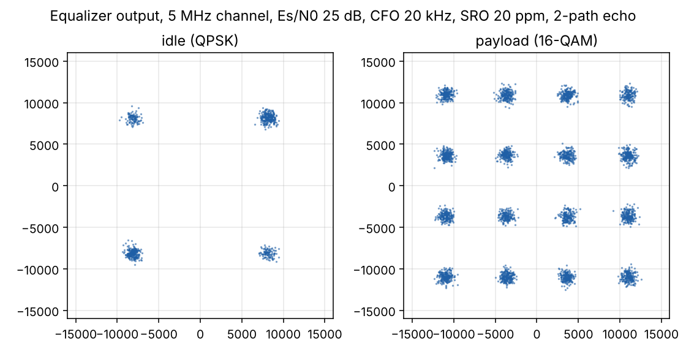

# z-nbrf (nb_radio) — narrowband (1–5 MHz) QPSK/16-QAM radio for the ZCU111 RFSoC

A complete PL modem for the ZCU111 RFSoC: framed packet radio, TX and RX, behind the RF Data
Converter. The channel bandwidth is programmable from **1.0 to 5.0 MHz** in a single register.
Payloads are QPSK or 16-QAM, and the receiver does fully digital, data-aided acquisition.
Packets move to and from the A53s over AXI DMA.

| | |
|---|---|
| Converters | RF-ADC tile 224 ch0 @ 2.048 GSPS / RF-DAC tile 228 ch0 @ 4.096 GSPS (mix-mode), IQ, x8 DDC/DUC with 48-bit NCO |
| RF channels | **2402 + n MHz** (default grid; any carrier the converters reach) — tuned by the RFDC NCOs, see §2a |
| Fabric | one 256 MHz clock domain; 1 complex sample/clk from the ADC, 2 samples/clk to the DAC |
| Channel BW | R = 8…63 → Rs = 32/R MBd → BW = Rs·1.25 = **40/R MHz** (5.00 … 1.00 … 0.63 MHz) |
| Pulse shaping | RRC α = 0.25, 41 taps (10 symbols) TX and RX |
| Payload | QPSK or 16-QAM (Gray), PRBS15-scrambled, CRC-16; 1–4095 bytes/frame |
| Throughput | 4 MBd × 4 b = 16 Mb/s raw at 5 MHz/16-QAM; 1.6 Mb/s at 1 MHz/QPSK |
| RX sensitivity | payload BER within ~0.5–1 dB of theory (uncoded), see below |
| Acquisition | CFO ±Rs/36 (±110 kHz @ 5 MHz, ±22 kHz @ 1 MHz) from a single 64-symbol preamble |
| Verified | 21-case end-to-end RTL regression + BER sweep in Verilator (TX → impaired channel → RX); Yosys UltraScale+ synthesis |
| Resources | ~19k LUT, ~31k FF, 299 DSP48E2, 2 RAMB36 (≈5% of the ZU28DR) |

---

## 1. Architecture

```
                         256 MHz (RFDC clk_adc0 -> clk_wiz)
 TX  AXIS bytes ─► tx_framer ─► mapper ─► RRC x4 ─► CFIR x2 ─► CIC xR ─► gain ─► RF-DAC (IQ, DUC x8, NCO)
     (DMA MM2S)    4 KB pkt buf   1 sps    4 sps     8 sps     256 MSPS
                   CRC16, PRBS15

 RX  RF-ADC (IQ, DDC /8, NCO) ─► CIC /R ─► CFIR /2 ─► RRC ─► AGC ─► Farrow+Gardner ─┬─► preamble_det ──┐
                       256 MSPS      8 sps     4 sps      4 sps   4 sps     1 sps       │  (rho, w, phi)    │ commit/est
                                                                                      └─► sym_proc ◄──────┘
                                                                                          A: delay line + CORDIC derotator
                                                                                          B: 5-tap DD-LMS EQ, slicer, PLL
                                                                                              │
                                                    AXIS bytes (DMA S2MM) ◄─ FIFO ◄─ deframer ◄┘
                                                    payload | seq | status        hdr CRC8, descramble, CRC16
```

### Rate plan

| Point | Rate | Samples/symbol |
|---|---|---|
| RF-ADC / RF-DAC | 2.048 / 4.096 GSPS real | — |
| RFDC AXIS (DDC/DUC x8, IQ) | ADC 256 MSPS (1 sample/clk); DAC 512 MSPS (2 samples/clk, x2 linear interp. in fabric, images < −95 dBc) | 8R |
| CIC output / input | 256/R MSPS | 8 |
| CFIR (x2) output / input | 128/R MSPS | 4 (RRC, AGC, timing recovery) |
| Symbols | 32/R MBd | 1 |

The fabric sees one complex sample per clock at 256 MHz. Everything after the CIC runs at
≤ 1/8 of the clock, so the symbol-rate processing uses small sequential FSMs with registered DSP
stages. The minimum symbol period is 64 clocks, and every FSM finishes well inside it, which
simulation assertions check.

### Blocks (all in `rtl/`)

| Module | Function | Notes |
|---|---|---|
| `cic_dec` / `cic_int` | N=4 CIC, runtime R and output shift | 40/44-bit internal, 3-stage round/shift/saturate |
| `fir_cplx` | Parallel complex FIR, pipelined adder tree, decimate-by-2 option | Coefficients generated by `scripts/gen_coefs.py` |
| CFIR (23 taps) | CIC droop compensation (+0.22 dB at band edge) + x2 rate change | Stopband < −100 dB |
| RRC (41 taps) | α = 0.25 matched filter | −40 dB stopband, −38.7 dB ISI floor (TX·RX) |
| `agc` | Multiplicative feedback AGC, Q10.12 gain (1/256…1024), α-max-β-min detector | Target calibrated so QPSK symbols land at ±8192 |
| `timing_rec` | Cubic Lagrange Farrow + Gardner TED + PI loop + mod-1 NCO | 4 sps in, 2 sps interpolants, 1 sps out |
| `preamble_det` | 64-symbol correlator, 4 non-coherent quarters, peak picking | Normalised metric ρ = 16m/E, threshold 0.4 |
| | Data-aided estimator: ω = ∠ΣC<sub>q+1</sub>C<sub>q</sub>*/16; quarters frequency-aligned (u = e<sup>−j16ω</sup>) then summed coherently | Phase extrapolated to preamble symbol 62 |
| `sym_proc` | Stage A: 4-deep alignment line + CORDIC derotator (owns φ). Stage B: 5-tap T-spaced complex DD-LMS EQ, QPSK/16-QAM slicer, 2nd-order DD PLL | Phase anchoring keeps the EQ phase-neutral (see §3) |
| `deframer` | Header (CRC-8) → payload demap → PRBS15 descramble → CRC-16 | EVM accumulator over the payload |
| `tx_framer` | Packet buffer (BRAM), CRC-16, scrambler, preamble/header/payload, PRBS-23 idle fill | Internal test generator for bring-up |
| `axil_regs` | AXI4-Lite register file | Radio clock domain (SmartConnect does the CDC) |

## 2a. Channel selection: 2402 + n MHz

The modem always works at complex baseband. **A channel is selected only by the RFDC NCOs**
(48-bit, mHz resolution), and every frame carries its own preamble, so hopping needs no modem
reset. Retuning takes one AXI write per converter plus an RFDC mixer update event.

```python
ol = NbRadioOverlay("nb_radio.bit")
ol.radio.configure(bw_mhz=1.0, mod="qpsk")   # 1 MHz grid -> R = 40
ol.set_channel(n)                            # 2402 + n MHz, n = 0..78
ol.set_channel(k, base=2402, spacing=2)      # any other grid, e.g. 2 MHz spacing
```

**Frequency plan at 2.4 GHz**

| | Sample rate | Nyquist zone at 2402–2480 MHz | NCO value (driver computes) |
|---|---|---|---|
| RF-ADC | 2.048 GSPS | 3 (odd) — undersampled | +354 … +432 MHz |
| RF-DAC | 4.096 GSPS | 2 (even) — **mix-mode** | −1694 … −1616 MHz |

The NCO is the RF frequency folded into (−Fs/2, Fs/2]. That folding never inverts the
spectrum, in any zone. At 2.048 GSPS the DAC would put 2.4 GHz in its 3rd zone at −17 dB with
stronger images, so the DAC runs at 4.096 GSPS. The fabric feeds it 2 samples/clk through a ×2
linear interpolator; its images are measured below −95 dBc. The ADC stays at 2.048 GSPS, and
2.4 GHz is plain bandpass sampling.

**Choosing the bandwidth for a 1 MHz grid** (RTL simulation, QPSK at 14 dB Es/N0 with a modulated
QPSK neighbour one channel away, ADC backed off to leave room for it):

| Setting | Occupied BW | Neighbour at +20 dB | +30 dB | +35 dB |
|---|---|---|---|---|
| R = 40 | 1.00 MHz (no guard) | −0.2 dB MER, 0 errors | −1.6 dB, 0 errors | −3.8 dB, first errors |
| R = 48 | 0.83 MHz (167 kHz guard) | −0.0 dB | −0.2 dB | −0.6 dB, 0 errors |

TX leakage into the adjacent 1 MHz channel is −41 dBc and into the alternate channel −79 dBc
(R = 40). R = 48 costs 17% throughput (0.667 MBd) and buys about 5 dB of adjacent-channel
rejection. Wider settings span several 1 MHz channels: R = 20 occupies 2 MHz, R = 8 occupies 5.

**RF front end you need:** a 2.4 GHz bandpass filter before the ADC. Undersampling folds 354–432 MHz,
1.62–1.69 GHz and every other alias zone onto the channel. Also put one after the DAC: mix-mode
emits an equal-order image at 4096 − f ≈ 1.62–1.69 GHz. Choose an XM500 path with the
high-frequency (1–4 GHz) baluns.

**Two boards over the air:** acquisition covers ±Rs/36, which is ±22 kHz at 1 MHz, i.e.
±9 ppm at 2.44 GHz. Either lock both boards to a common 10 MHz reference via the LMK input on
the ZCU111, or use software AFC: `set_carrier(..., rx_offset_hz=cfo)` trims the RX NCO from
`status()['cfo_hz']`.

## 2. Frame format

```
| idle QPSK (PRBS-23, ≥ IFS) | preamble 64 sym | header 32 sym | payload + CRC-16 (scrambled) | idle ...
                               BPSK on I=Q       BPSK on I=Q     QPSK: 4 sym/byte, 16-QAM: 2 sym/byte
```

* **Preamble.** 64 ±1 symbols on the diagonal (±S(1+j)). The sequence was searched for low
  sidelobes of the 4-quarter non-coherent metric (main/side = 10.7 dB).
* **Header.** 32 bits, one bit per symbol on the diagonal. That is 3 dB better per bit than
  QPSK, so header loss sits far below payload frame loss down to ~7 dB Es/N0.
  `mod[31:28] | len[27:16] | seq[15:8] | CRC-8(0x07)[7:0]`.
* **Payload.** Bytes MSB first, PRBS15 (1+x¹⁴+x¹⁵, DVB init) additive scrambling,
  CRC-16-CCITT (0x1021, init 0xFFFF) appended. The RX checks for a zero remainder.
* **Idle.** Between frames the TX keeps sending random QPSK so the RX loops stay locked. The
  minimum gap is set by `TEST[31:16]`.
* **RX output** per frame, as one DMA packet: `payload[len] | seq | status`, where
  status bit0 = CRC ok and bit1 = 16-QAM.

## 3. Design notes worth knowing

* **Acquisition.** On a preamble commit, the delay-line entry holding preamble symbol 62 is
  tagged. When it reaches the derotator, the estimator's phase and frequency are loaded and the
  PLL/LMS updates are held for 5 symbols. The deframer uses the same tag (after the EQ's
  2-symbol centre delay) as the frame reference, so alignment is exact by construction.
* **Phase anchoring.** A DD-LMS equalizer inside a DD-PLL can park a k·90° rotation in its taps.
  The preamble re-initialises the PLL but cannot see that rotation, which produced rotated
  headers in simulation. Every symbol, the centre tap's angle is moved into the PLL phase and
  all taps are counter-rotated. The output is unchanged, the taps stay phase-neutral, and the
  ambiguity lives only in φ, which the preamble overwrites.
* **Wide-CFO phase estimate.** At ≥ ~5°/symbol the four quarter correlations span more than
  180°, and their plain vector sum flips sign. Aligning each quarter with u = e<sup>−j16ω</sup>
  before summing removes that limit, so pull-in is set only by the frequency estimator
  (|16ω| < π).
* **Modular phase arithmetic.** Every phase extrapolation is done mod 2³² without halving a
  wrapped value; (61ω)/2 is computed as 30ω + ω/2. An early version got this wrong and lost
  frames at large CFO.
* **Timing.** Every multiplier output is registered before it feeds an adder, clamp or shift,
  and the CIC/FIR/AGC output stages are split into round, shift and saturate.

## 4. Register map (base 0xA0040000 in the reference BD)

| Off | Name | Bits |
|---|---|---|
| 0x00 | ID | RO `0x4E425231` ("NBR1") |
| 0x08 | CTRL | 0 tx_en · 1 rx_en · 2 test_gen · 3 digital_loopback · 4 soft_reset (self-clr) · 5 eq_en · 6 pll_en · 7 tx_16qam |
| 0x0C | RATE | [5:0] R = 8…63 |
| 0x10 | CIC_SHIFT | [5:0] rx = ⌈4·log₂R⌉ · [13:8] tx = ⌈3·log₂R⌉ |
| 0x14 | TX_GAIN | Q2.14; driver normalises R³/2^tx_shift and applies back-off |
| 0x18 | TEST | [11:0] test frame length · [31:16] min idle symbols |
| 0x1C | AGC | [15:0] target (11650) · [20:16] μ shift (31 = freeze) |
| 0x20 / 0x24 | TED / PLL | [4:0] Kp shift · [12:8] Ki shift (defaults 3 / 10) |
| 0x28 | EQ | [4:0] LMS μ shift (6) |
| 0x2C | DET | [7:0] ρ threshold ×256 (102 = 0.4) |
| 0x40–0x4C | RX_OK, RX_CRC_ERR, RX_HDR_ERR, TX_FRAMES | counters |
| 0x50 | RX_OVF | bytes dropped (RX FIFO full) |
| 0x54 | PLL_FREQ | s32; CFO [Hz] = v/2³²·Rs |
| 0x58 / 0x5C | EVM_ACC / EVM_N | EVM = ACC·256/N / (2·8192²) over the last payload |
| 0x60 | AGC_GAIN | Q10.12 |
| 0x64 / 0x68 | PEAK_M / PEAK_E | ρ of last detection = M/E |
| 0x6C | LAST_HDR | last received header word |
| 0x70 / 0x74 | TED_V / DET_CNT | timing loop word, detection count |

`sw/nb_radio_regs.h` has C definitions. `sw/nb_radio.py` is a PYNQ driver that does all the
register math (`configure(bw_mhz=…, mod=…)`, `send()`, `recv()`, `status()` with MER and CFO).

## 5. Verification

Everything below is RTL simulation (Verilator 5). The testbench (`tb/tb_top.sv`) drives
DMA-style packets into TX. A 256 MSPS complex channel model then applies sample-rate offset
with fractional delay, a two-path echo (0.25∠40° at ½ symbol), CFO, AWGN at a set Es/N0 and
12-bit ADC quantisation. The model feeds RX, and every payload byte is checked.

```
tb/regress.sh                 # 21 cases, ~6 min
python3 scripts/ber_sweep.py  # BER vs Es/N0, 5 MHz and 1 MHz channels
tb/run.sh +R=13 +MOD=1 +ESN0=20 +CFO=30000 +SRO=20 +MP=1 +NPKT=20   # any single scenario
```

**Regression (all pass):**

| Case | Result |
|---|---|
| clean 5 MHz QPSK / 16-QAM, clean 1 MHz 16-QAM | 0 bit errors, MER 36–37.5 dB (RRC ISI floor 38.7 dB) |
| digital loopback, internal test generator, RX backpressure (25% tready) | pass |
| 4000–4095-byte 16-QAM frames with 20 kHz CFO + 20 ppm | pass |
| 1–3-byte frames | pass |
| 2.5 / 3.08 / 1 MHz channels, 16-QAM, echo + CFO + SRO, 30 dB | pass, MER ≈ 28 dB |
| 5 MHz QPSK @ 10 dB, all impairments, 50 kHz CFO | 10/10 headers, BER 3.7e-4 |
| 5 MHz 16-QAM @ 22 dB, all impairments | 0 bit errors |
| 1 MHz QPSK @ 12 dB, all impairments | 0 bit errors |
| CFO +100 kHz / −110 kHz @ 5 MHz, −22 kHz @ 1 MHz | pass (edge of ±Rs/36) |





## 6. Building

**Simulation.** Needs Verilator ≥ 5.0 and Python with numpy, scipy and matplotlib.
`tb/run.sh`, `tb/regress.sh`. Regenerate coefficients with `python3 scripts/gen_coefs.py`.

**Bitstream.** Needs Vivado 2022.x or later with the ZCU111 board files.
```
vivado -mode batch -source vivado/build.tcl -tclargs 8
# -> build/vivado/nb_radio.bit / .hwh (PYNQ) / .xsa (Vitis, PetaLinux)
```
`vivado/bd.tcl` builds the block design: PS, RFDC, clk_wiz on `clk_adc0`, the modem as a
module reference (through the Verilog wrapper `nb_radio_wrap.v`), AXI DMA, async AXIS FIFOs
and SmartConnects. Carrier NCOs and the sample rate are set at the top of the file.

## 7. Bring-up on the board

1. **Clocks.** Program the LMK04208 to 122.88 MHz and the LMX2594 to 409.6 MHz. On PYNQ,
   `xrfclk.set_ref_clks(lmk_freq=122.88, lmx_freq=409.6)` does this, and `NbRadioOverlay`
   calls it for you. `clk_adc0`, and with it the radio clock and reset, only becomes valid
   after the ADC tile has started.
2. **Cabling.** Connect DAC228 CH0 → 2.4 GHz BPF → 30–40 dB attenuation → 2.4 GHz BPF →
   ADC224 CH0, on XM500 paths with the 1–4 GHz baluns. Change the tile/channel in `bd.tcl`
   if your XM500 routing differs.
3. **Run** `sw/loopback_test.py`. It works through three stages. Digital loopback exercises the
   PL and DMA only. Then the internal test generator runs on channel 0 while the script tries
   all four NCO sign combinations, because conventions differ between RFdc driver versions.
   * No detections at all means the RX sign is wrong: the signal lands ~700 MHz off.
   * Detections but every header failing means the TX sign is wrong: the spectrum is inverted,
     and the diagonal header symbols flip.
   Finally it scans channels 0…78 with DMA packets, in QPSK and 16-QAM.
4. **Levels.** The AGC covers 1/256…1024, so anything from about −50 dBFS up works.
   Leave 30+ dB of ADC headroom if strong neighbours or Wi-Fi share the band; processing gain at
   1 MHz is about 30 dB.
5. **Over the air between two boards.** See §2a: use a common reference or software AFC.

## 8. Status and caveats

**Verified here:** RTL function and performance in simulation (above). The full design also
elaborates under slang (strict IEEE 1800) and synthesises with Yosys `synth_xilinx -family xcup`.
The resource estimate for the modem alone (Vivado usually comes in lower on LUTs):

| LUT | FF | DSP48E2 | RAMB36 |
|---|---|---|---|
| ~18.8k (4.4%) | ~31.2k (3.7%) | 299 (7.0%) | 2 (0.2%) |

The four parallel FIRs account for most of the DSPs (2 × (41 + 23) × 2 = 256); folding the
symmetric taps would halve that if it ever matters.

**Not run here (no Vivado in this environment):**
* `bd.tcl` and `build.tcl` have not been executed. RFDC `CONFIG.*` property names and enum
  values (`ADC_Mixer_Mode`, `ADC_Data_Type`, `*_Data_Width`) follow the Gen1 IP but differ
  between IP versions. If Vivado rejects one, set the same values in the RFDC GUI: ADC 2.048
  GSPS and DAC 4.096 GSPS, 409.6 MHz refclk with PLL, IQ, decimation/interpolation 8, fine
  mixer, ADC 1 / DAC 2 samples per AXIS cycle, 256 MHz fabric clock, DAC Nyquist zone 2
  (mix-mode), ADC Nyquist zone odd.
* The RFDC stream mapping is assumed to be ADC `m00_axis` = I and `m01_axis` = Q, and DAC
  `s00_axis` = {Q1, I1, Q0, I0} (16 bits each, sample 0 earliest in the LSBs). Check it against the IP's port view or example design.
  An I/Q swap shows up as a mirrored spectrum, i.e. CFO with the wrong sign plus failed
  detection.
* Timing closure at 256 MHz is untested. The RTL was restructured with that target in mind,
  but the parallel FIRs, the CIC integrators and the CORDIC barrel shifter are the paths to
  watch in the first implementation run.

**Natural next steps:** a convolutional or LDPC code on the payload (it's uncoded today), a
continuous-pilot or burst-preamble TX mode, AFC writing straight to the RFDC NCO, a
fractionally-spaced EQ for harsher multipath, and a second channel (the RFDC has 8 of each).

## File map

```
rtl/        SystemVerilog modem (+ Verilog wrapper for IP Integrator)
tb/         Verilator testbench, run.sh, regress.sh
scripts/    gen_coefs.py (filters/preamble/CORDIC), ber_sweep.py, plots.py, syms.py
vivado/     bd.tcl (block design), build.tcl (project → bitstream/xsa), nb_radio.xdc
sw/         nb_radio.py (PYNQ driver), loopback_test.py, nb_radio_regs.h
docs/       DESIGN_LOG.md (decisions, past bugs, open items), ber.png, constellation.png, results/
CLAUDE.md   commands and conventions for working in this repo
```
